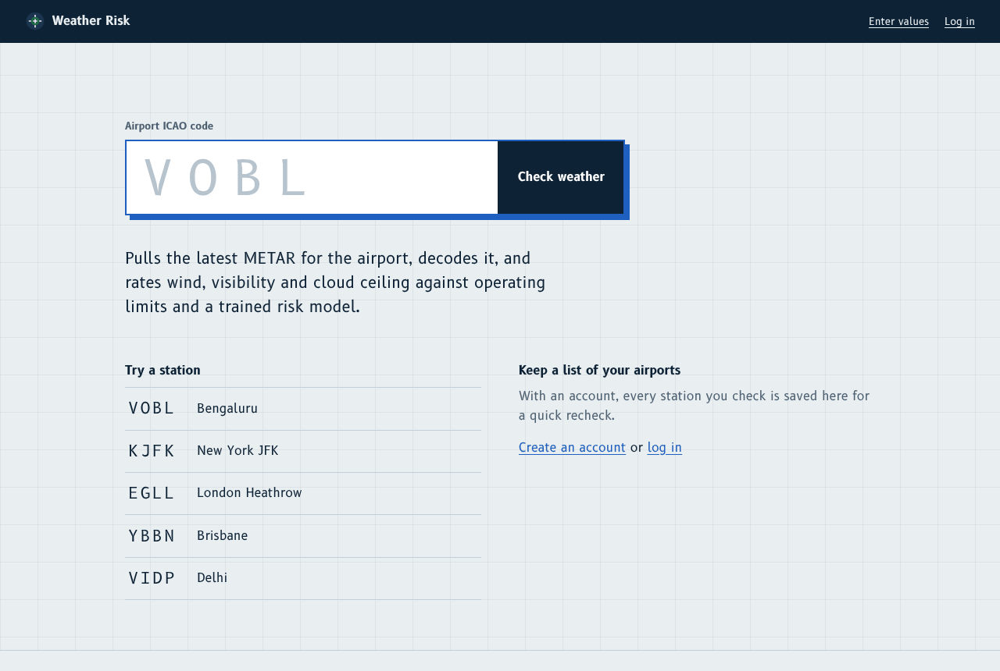
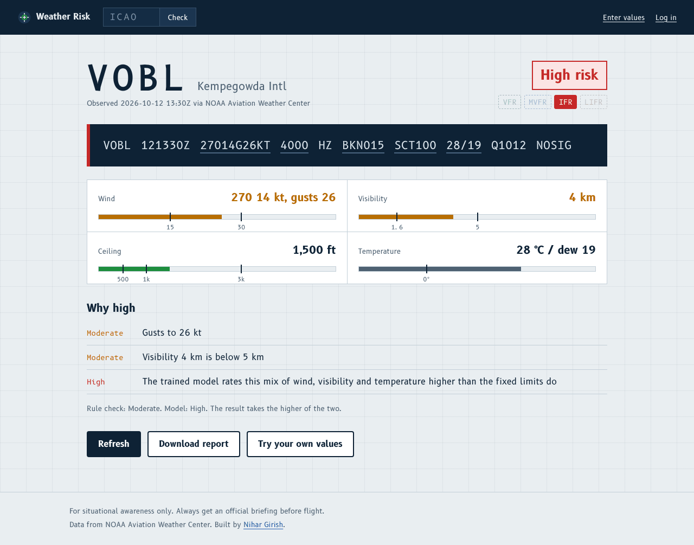
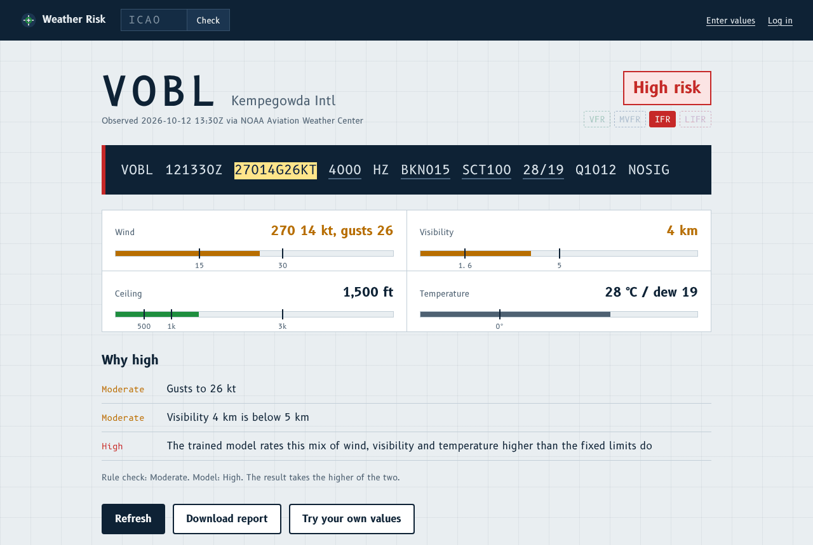
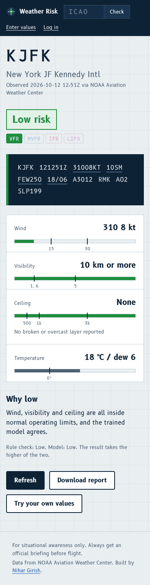

# ICAO Weather Risk

Type an airport's four letter ICAO code and the app fetches its latest METAR, decodes it, and rates the weather risk from wind, gusts, visibility and cloud ceiling.

## How it works

Start from the home page. Type a code like `VOBL` or `KJFK`, or pick one of the sample stations. With an account, your recent stations show up here too.



The result page opens with the station, the overall risk and the FAA flight category (VFR, MVFR, IFR or LIFR). Below that sits the raw METAR, then a gauge for each value with its limits marked, then the reasons behind the rating.



The raw METAR and the gauges are linked. Hover a group like `27014G26KT` and the wind gauge lights up. Hover the wind gauge and the group lights up. This runs on CSS alone, with no JavaScript.



On a phone the gauges stack into one column. "Download report" saves a plain text summary you can keep with your flight notes.



You can also skip the lookup and test your own numbers, such as a forecast, on the "Enter values" page.

## How the rating works

The app runs two checks and keeps the worse result.

The first check compares each value with fixed operating limits:

| Value | Moderate | High |
|---|---|---|
| Wind | 15 kt or more | 30 kt or more |
| Gusts | 25 kt or more | 35 kt or more |
| Visibility | under 5 km | under 1.6 km |
| Ceiling | under 1,000 ft | under 500 ft |

The second check is a scikit-learn random forest (`models/weather_risk_model.pkl`) trained on wind speed, visibility and temperature. It can flag a mix the fixed limits miss, like moderate wind in poor visibility. It never sees gusts or ceiling, so the limits handle those. The result page names the check that set the rating.

## Weather data

With no setup, the app reads METARs from NOAA's Aviation Weather Center API, which needs no key. Set `AVWX_TOKEN` and it uses [AVWX](https://avwx.rest) instead. Both sources go through the same parser, which converts visibility to kilometres whatever unit the station reports.

## Accounts

Anyone can look up a station. If you sign up, the home page keeps your last twelve stations for a one click recheck. Passwords get hashed with Werkzeug's PBKDF2. Accounts live in a JSON file (`instance/users.json` by default). That works for a demo, but for real use point `USERS_FILE` at a persistent disk or move accounts into a database.

## Project layout

```
app/
  __init__.py     App factory and routes
  metar.py        AWC and AVWX clients, the Observation model, METAR tokeniser
  risk.py         Operating limits, flight category, model wrapper
  users.py        JSON user store with lookup history
  templates/      Jinja templates
  static/         CSS and self hosted B612 fonts
models/
  weather_risk_model.pkl
tests/
  test_app.py     Parsing, limits, routes, accounts (network calls mocked)
docs/screenshots/ Images used in this README
wsgi.py
```

## Run it locally

```bash
python -m venv .venv
source .venv/bin/activate          # Windows: .venv\Scripts\activate
pip install -r requirements-dev.txt

export FLASK_SECRET_KEY=$(python3 -c "import secrets; print(secrets.token_hex(32))")
python wsgi.py                     # http://localhost:5000
pytest
```

`.env.example` lists every variable.

## Deploy

The `Procfile` runs `gunicorn wsgi:app`, so Render, Railway and Heroku work as is. Set `FLASK_SECRET_KEY`, plus `AVWX_TOKEN` if you want AVWX.

`requirements.txt` pins scikit-learn to 1.7.1 because that version saved the model. Retrain the model before you upgrade it.

## Design notes

- The page looks like a daylight aeronautical chart: cool grey paper with a faint grid and navy ink.
- B612, the typeface Airbus commissioned for cockpit displays, sets the interface. B612 Mono sets the raw METAR. The app serves both fonts itself.
- Colour carries meaning and nothing else: green, amber and red for risk, and the standard FAA colours for flight categories.

Use this for situational awareness only, and get an official briefing before you fly.
